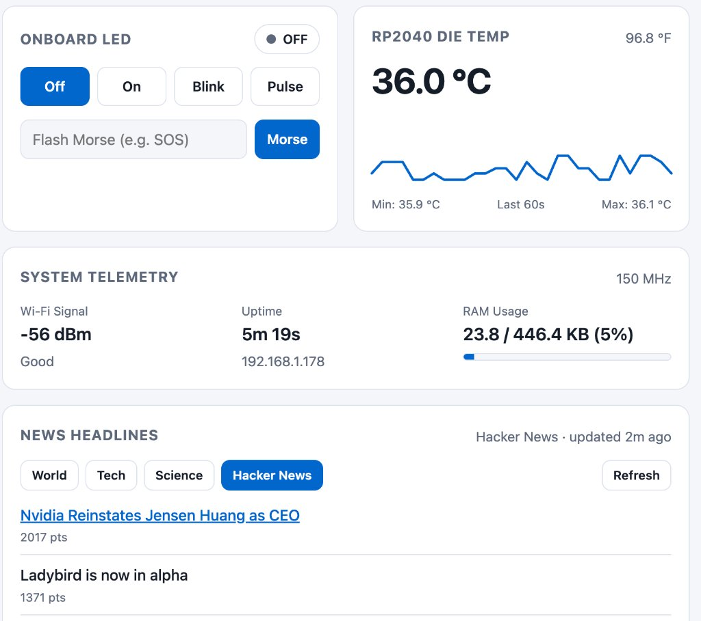

# Raspberry Pi Pico W — Web Control & Telemetry Dashboard

A standalone MicroPython Wi-Fi web app for the **Raspberry Pi Pico W / Pico 2 W** requiring **no additional hardware**.



## Features
- **World Clock:** Live ticking clocks for **Local Time**, **GMT / UTC**, and a **Custom** user-editable IANA time zone (defaults to local time, persisted to flash, with 12h/24h toggle).
- **Onboard LED Control:** Switch between `Off`, `On`, `Blink`, `Heartbeat`, or flash custom text in **Morse code**.
- **Live Temperature Chart:** Reads the built-in temperature sensor (`ADC(4)`) every 2 seconds and renders a 60-second SVG sparkline.
- **System Telemetry & Controls:** Live Wi-Fi signal strength (RSSI), RAM & flash storage usage, active/unique connection & request counter, uptime, CPU frequency, current date pill, editable dashboard name, a **Hide Host/IP** privacy toggle, a **Light/Dark** theme toggle, and a two-click **Reboot** button.
- **Local Weather:** Auto-detects your default location via IP geolocation, lets you manually switch to any city (via Open-Meteo geocoding, persisted to flash), and fetches live temperature, conditions, humidity, wind, and daily high/low from Open-Meteo (free, no API key).
- **LAN Scratchpad:** Persistent notepad stored on the Pico's flash (`notes.txt`) for passing quick text/links across devices on your Wi-Fi.
- **Wi-Fi Scanner:** On-demand 2.4 GHz network scanner showing nearby SSIDs, channels, signal strength, and security.
- **News Headlines:** Fetches live headlines directly from the Pico W for **BBC World**, **BBC Tech**, **BBC Science**, and **Hacker News** with 10-minute in-memory caching.
- **Zero External Dependencies:** `index.html` is streamed directly from flash.

## Setup

### 1. Flash MicroPython (if not already installed)
1. Download the latest MicroPython `.uf2` firmware for your board:
   - **Pico W:** [micropython.org/download/RPI_PICO_W/](https://micropython.org/download/RPI_PICO_W/)
   - **Pico 2 W:** [micropython.org/download/RPI_PICO2_W/](https://micropython.org/download/RPI_PICO2_W/)
2. Hold down the **BOOTSEL** button while plugging the board into your computer via USB.
3. Drag and drop the `.uf2` file onto the `RPI-RP2` / `RP2350` drive. The board will reboot automatically.

### 2. Configure Environment Variables
Copy `.env.example` to `.env` and enter your **2.4 GHz** Wi-Fi network credentials (and optional weather coordinates):

```bash
cp .env.example .env
```

Edit `.env`:
```dotenv
WIFI_SSID=your-2.4ghz-ssid
WIFI_PASSWORD=your-wifi-password
HOSTNAME=pico-w-dashboard
PORT=80

# Optional weather location (defaults to Manila)
WEATHER_CITY=Manila
WEATHER_LAT=14.5995
WEATHER_LON=120.9842
```

### 3. Upload Files to the Pico W

**Option A — Using `mpremote` (terminal):**
```bash
pip install mpremote
mpremote cp .env env.py news.py weather.py index.html main.py :
mpremote reset
mpremote repl
```

**Option B — Using Thonny IDE:**
1. Open Thonny and select **MicroPython (Raspberry Pi Pico)** in the bottom-right interpreter menu.
2. Upload `.env`, `env.py`, `news.py`, `weather.py`, `index.html`, and `main.py` to the Raspberry Pi Pico root directory.
3. Click **Run** (or press the reset/replug USB).

### 4. Open the Dashboard
- While connecting, the onboard LED blinks rapidly; once connected, it double-blinks and prints the URL in the serial console:
  ```text
  Connected! Open http://192.168.x.x/ in your browser.
  ```
- Open that URL from any phone or computer on the same Wi-Fi network.

## Project Structure
- `main.py` — Async HTTP server, Wi-Fi auto-reconnect, LED/Morse controller, telemetry, Wi-Fi scanner, and flash notes API
- `index.html` — Self-contained responsive web dashboard
- `env.py` — Minimal `.env` loader for MicroPython
- `news.py` — Streaming RSS (BBC) and JSON (Hacker News) headline fetcher with 10-minute cache
- `weather.py` — Open-Meteo local weather fetcher with 15-minute cache
- `.env.example` — Template for Wi-Fi and weather environment variables

## API Endpoints
- `GET /` — Serves `index.html`
- `GET /api/status` — Returns JSON telemetry, flash stats, and LED state
- `POST /api/led` — Updates LED mode, e.g. `{"mode": "morse", "text": "SOS"}`
- `GET /api/news?feed=world&refresh=0` — Returns cached or refreshed headlines (`world`, `tech`, `science`, `hn`)
- `GET /api/weather?refresh=0` — Returns cached or refreshed Open-Meteo weather data
- `POST /api/weather/location` — Sets weather location by city (`{"city": "Tokyo"}`) or auto-detect (`{"auto": true}`)
- `POST /api/title` — Updates and persists the dashboard title (`{"title": "..."}`)
- `POST /api/timezone` — Updates and persists the custom World Clock time zone (`{"timezone": "America/New_York"}` or `""` for local)
- `GET /api/wifi/scan` — Scans nearby 2.4 GHz Wi-Fi networks
- `GET /api/notes` / `POST /api/notes` — Reads or saves the LAN scratchpad (`notes.txt`)
- `POST /api/reboot` — Reboots the Pico W
